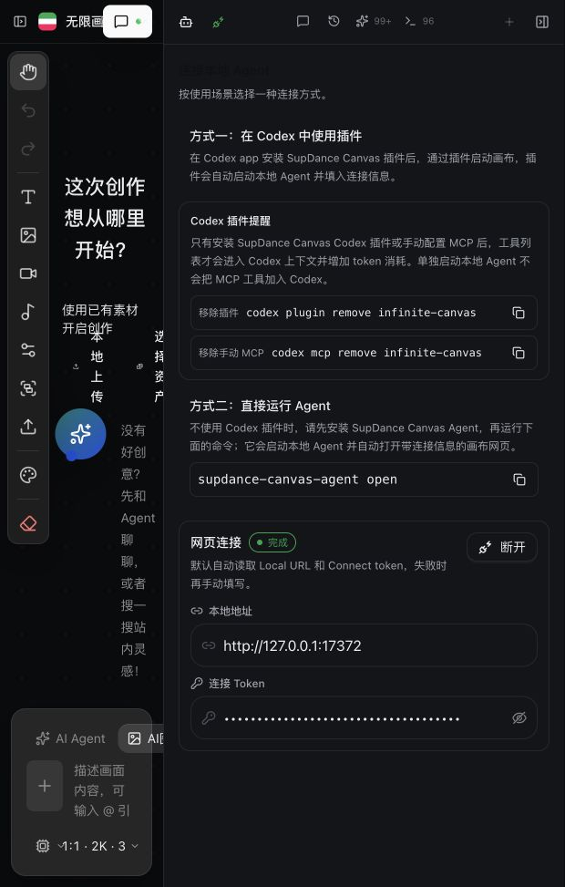

# Compatibility and acceptance

## Latest website connection check

The installed plugin tools and local Agent can start, but the current website
bundle still uses the legacy SSE query-token handshake. Its `/config` request
reaches the local Agent; `GET /events?token=...` receives `401 invalid event
ticket`, so the Agent reports no connected canvas and `canvas_get_state` cannot
read it. A direct comparison confirmed that `POST /events-ticket` followed by
`GET /events?ticket=...` returns `hello` with protocol version 6. Ordinary API
requests also need the `x-canvas-agent-token` header. The matching website fix
is in the separate `Blacklake-Go/canvas` repository; deploy it before treating
the previous successful desktop acceptance as current.

## Codex desktop acceptance — 2026-10-21

| Layer | Result | Evidence and limit |
| --- | --- | --- |
| Codex desktop plugin | Loaded | `supdance-canvas@supdance-local` version `0.1.7` is installed and enabled; the current task exposed the SupDance Canvas MCP tools. |
| Local Agent | Connected | `@supdance/canvas-agent` version `0.1.3`; loopback health endpoint returned `200` with protocol version `6`. |
| Current website canvas | Connected | [无限画布 3](https://canvas.supdance.com/canvas) displayed the Agent as connected. `canvas_get_state` returned the same project ID, title `无限画布 3`, and `hasCanvas: true`. |
| Refresh reconnect | Passed | After refreshing the canvas page, `canvas_get_state` continued to return `hasCanvas: true`. |
| Canvas content | Unchanged | The accepted state had zero nodes, zero connections, and no selected nodes. No node edits or media generation were performed. |

## Release candidate plugin 0.1.7 / Agent 0.1.3 — 2026-10-18 (historical)

| Layer | Result | Evidence and limit |
| --- | --- | --- |
| Agent package | Built and packed | `@supdance/canvas-agent@0.1.3` needs Node.js 18+. TypeScript build succeeded and 135/135 package tests passed. |
| Codex CLI plugin | Connected | Plugin 0.1.6 loaded MCP tools and read the live board with `canvas_get_state`, including under a restricted PATH. Plugin 0.1.7 adds the supplied logo to listing metadata; the MCP files are unchanged. |
| Website connection | Connected | Local Chrome opened `https://canvas.supdance.com/canvas`; the page displayed **Codex 已连接** and the text node. No connection token appeared in the browser URL. |
| Agent restart | Reconnected automatically | An isolated candidate Agent on `127.0.0.1:17373` connected to the same live board. Stopping it changed the page to **连接失败**; restarting it restored **Codex 已连接** without user input. |
| Desktop Codex app | Pending at that time | Logs showed `No such file or directory` for the Agent command and the CLI then reported that the portable stdio command must be a bare name or a path inside the plugin. Plugin 0.1.6 fixed those MCP launch issues. The desktop check was completed on 2026-10-21; see the current acceptance above. |
| Paid generation | Not exercised | No image, video, or audio generation was invoked. Asset storage and credit settlement are outside this connection acceptance. |

The isolated 0.1.3 Agent used `SUPDANCE_CANVAS_CONFIG_DIR` and port `17373`; it did not replace the unrelated `@supdance/canvas-agent-workbuddy` service on port `17372`. The 0.1.3 startup output does not print the long-lived connect token. Plugin 0.1.7 uses the MCP launch script added in 0.1.6 and includes the supplied logo; the Agent package remains 0.1.3.

The successful CLI tool call used `--approve-for-me`. The default CLI policy on this workstation rejected the same MCP call with “MCP tool call requires approval, but approval policy is never.” Plugin registration alone does not imply tool calls are approved under every Codex policy.

## Compatibility

- **Codex CLI:** plugin-aware CLI `0.162.0-alpha.17.2` on this macOS host.
- **Node.js:** package requirement `>=18`; tested locally with `v26.7.0`.
- **Protocol:** Agent/website protocol version 6. Browser requests use `x-canvas-agent-token`; SSE starts with a one-use, origin/client-bound ticket from `POST /events-ticket`. Ticket lifetime is 60 seconds.
- **Agent reuse:** a newer patch in the same `0.1.x` line is accepted only if protocol 6 matches; unrelated, older, and incompatible services are rejected.
- **Distribution:** local Codex marketplace and npm tarball. The Agent has not been published to npm; install from this repository's release tarball.
- **GitHub marketplace:** the repository is public. This desktop currently has `supdance-canvas@supdance-local` version `0.1.7` installed from a local checkout; a fresh install directly from GitHub was not performed in this acceptance.
- **Platforms:** macOS browser workflow was exercised. Windows and Linux launch behavior and the portable non-Codex plugin format are unverified.

## Website source provenance

The live site served `index-CwaX-uw5.js` and `index-BxQPPkSm.css` on 2026-10-18. The JavaScript SHA-256 was `2572fa0b87d761f852fa2a479d1ff2fe1b58055b10468c8273bae860469d13d5`. The public bundle contains the ticket endpoint, auth header, protocol checks, fragment bootstrap, and history replacement. Its exact source commit is still unknown. No website files were changed or deployed during this acceptance.

[`website-adaptation.patch`](website-adaptation.patch) is based on `infinite-canvas` commit `f1ad63d`; it is reference material until the exact source for the live bundle is identified.

## Previous acceptance — 2026-10-16

The earlier 0.1.0 plugin loaded in a fresh Codex task and read a current board with `hasCanvas: true`; it created no content. That older live Agent recovered from a restart only after a manual **连接** click. This historical result should not be used as evidence for candidate 0.1.3. The separate current restart observation above establishes automatic browser reconnection for 0.1.3.

## Desktop MCP launch investigation — candidate 0.1.7 (historical)

The fresh desktop task's Codex log recorded `MCP startup failed: No such file or directory (os error 2)` for `supdance-canvas`. The plugin command name resolved in a login terminal but not in the desktop process environment. Plugin 0.1.5 then exposed a second issue: Codex's portable MCP loader rejects an absolute shell command, requiring a bare executable or a path inside the plugin. Plugin 0.1.6 uses `./scripts/mcp-launcher.sh` (a login zsh script) in both MCP manifests, and the root `plugin.json` declares `mcpServers: "./.mcp.json"` under `extensions.com.openai`. The launcher completed MCP `initialize` under `PATH=/usr/bin:/bin`, and a fresh CLI task called `canvas_get_state` successfully (`hasCanvas: true`, title `无限画布 2`, zero nodes). Plugin 0.1.7 adds `./assets/logo.png` to the plugin metadata without changing MCP configuration. This earlier pending item was resolved by the desktop acceptance recorded above on 2026-10-21.
