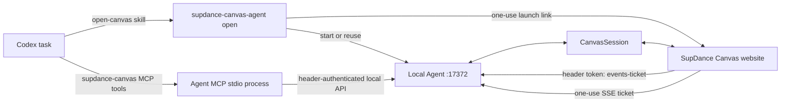

# SupDance Canvas Codex plugin plan

## Goal

Provide an independent Codex plugin that connects the current Codex task to
`https://canvas.supdance.com/canvas` without depending on the upstream
Infinite Canvas plugin registration or Agent package.

## Architecture

### Codex plugin

- Portable manifest: `plugins/supdance-canvas/plugin.json` and `mcp.json`.
- Codex compatibility manifest: `plugins/supdance-canvas/.codex-plugin/plugin.json`,
  pointing to the root `.mcp.json`; this preserves the currently working Codex
  marketplace installation path.
- MCP key: `supdance-canvas`.
- Skills: `open-canvas` starts or reuses the Agent and opens the website;
  `canvas` describes how to read and operate the current board.
- `open` defaults to a new canvas; `--mode=recent` opens the most recent
  canvas, `--mode=choose` asks the website to select one, and `--project=<ID>`
  opens the specified canvas.
- Tool names and protocol remain compatible with website Agent protocol 6.

### Local Agent

- Package: `@supdance/canvas-agent` 0.1.1; executable:
  `supdance-canvas-agent`.
- MCP process uses stdio and forwards tools to the local HTTP Agent.
- HTTP Agent binds to `127.0.0.1:17372` and uses the separate
  `~/.supdance-canvas/` configuration and workspace.
- Health identity reports the package and protocol versions; opening the canvas
  rejects an old or incompatible process with a direct upgrade/restart message
  instead of reusing it silently.
- The long-lived credential stays in the protected local config and is sent to
  the browser only in `x-canvas-agent-token` headers.

### Website connection

1. `open` checks the local Agent identity and starts it if needed.
2. Agent returns a one-use, 60-second local launch link.
3. The link redirects to SupDance Canvas with bootstrap data in the fragment.
   The page reads it and immediately removes it from browser history.
4. The page keeps the long-lived token in the current tab's `sessionStorage`.
5. Authenticated API calls use a request header. The page requests an SSE
   ticket over an authenticated POST; the Agent binds it to the exact site
   origin and client ID and permits one use within 60 seconds.
6. On connection loss, the page renews the ticket about every 3 seconds. After
   three consecutive failures the connection panel reports the Agent as offline
   and keeps manual reconnect available; a successful SSE open resets the count.

## Source adaptation

The Agent and plugin are derived from the installed `@basketikun/canvas-agent`
and Infinite Canvas plugin source under its MIT license. The fork preserves the
existing Canvas tools and protocol while changing package branding, MCP
identity, port, configuration directory, startup flow, CORS policy, and browser
authentication. `NOTICE.md` and the retained LICENSE document the source.

The paired website source changes the default address and connection copy,
moves browser requests to header authentication, makes the token tab-scoped,
uses object URLs for authenticated image previews, and adds the ticket-based SSE
handshake. Keep Agent and website changes on matching releases.

## Acceptance and release gates

- Plugin appears enabled in `codex plugin list`; a fresh Codex task loads tools.
- `canvas_get_state` reads the current page; a text-node operation proves a
  website write without generation.
- Restarting the Agent and dropping the SSE connection recovers without
  exposing the long-lived token in a URL.
- Verify one-use, origin binding, client binding, 60-second expiry, the
  approximately 3-second retry cadence, and offline state after three failures.
- Do not claim image generation, storage, or credit settlement from connection
  checks. Do not run a paid generation as part of plugin acceptance.
- Package 0.1.1 requires the paired website source release. The independent
  npm package has not been published; until then, distribute from a checkout or
  supplied tarball.
